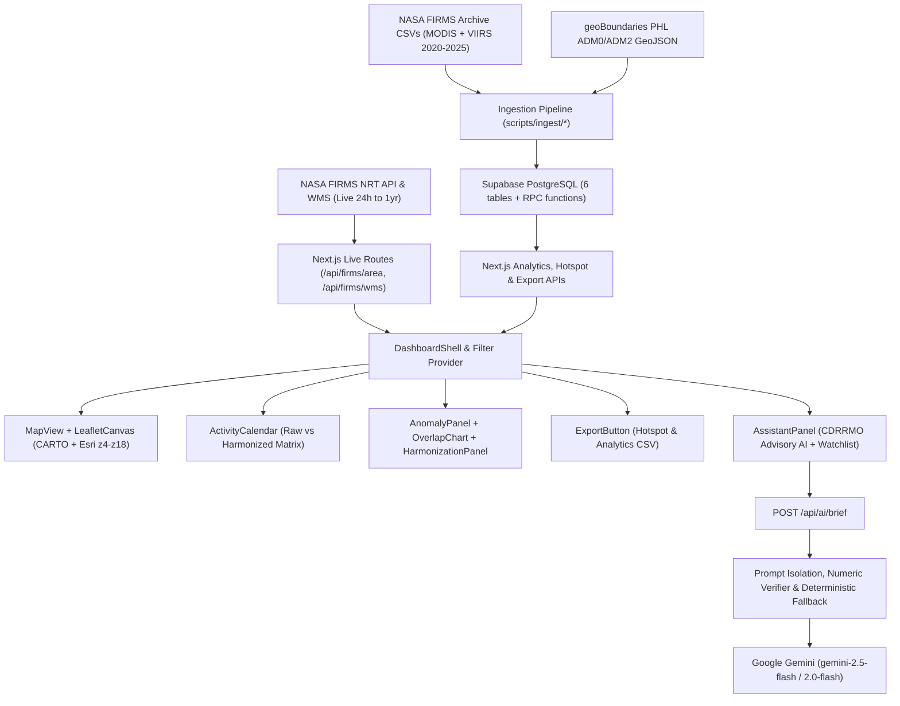

# FIRE MEMORY Architecture & Technical Reference

This document provides the complete technical reference for **FIRE MEMORY** as implemented in the workspace, covering architecture, data ingestion, database schema, HTTP API routes, cloud-free map rendering, analytics, CDRRMO Advisory AI guardrails, and automated testing.

---

## 1. High-Level System Architecture

---

## 2. Application Routes & UI Components

All four main workspace pages share a single client orchestrator ([`DashboardShell.tsx`](../src/components/dashboard/DashboardShell.tsx)) wrapped in [`DashboardFiltersProvider.tsx`](../src/components/dashboard/DashboardFiltersProvider.tsx) inside [`layout.tsx`](../src/app/layout.tsx):

| Route | Feature Key | Primary Components |
|---|---|---|
| `/` | `"map"` | [`MapView.tsx`](../src/components/map/MapView.tsx), [`LeafletCanvas.tsx`](../src/components/map/LeafletCanvas.tsx), [`AssistantPanel.tsx`](../src/components/assistant/AssistantPanel.tsx) |
| `/calendar` | `"calendar"` | [`ActivityCalendar.tsx`](../src/components/calendar/ActivityCalendar.tsx) |
| `/anomaly` | `"anomaly"` | [`AnalyticsPanels.tsx`](../src/components/charts/AnalyticsPanels.tsx) (`AnomalyPanel`, `OverlapChart`, `HarmonizationPanel`) |
| `/export` | `"export"` | [`ExportButton.tsx`](../src/components/export/ExportButton.tsx) |
| `/assistant` | *(redirect)* | Redirects cleanly to `/` ([`src/app/assistant/page.tsx`](../src/app/assistant/page.tsx)) |

Shared sidebar branding uses [`FireMemoryLogo.tsx`](../src/components/brand/FireMemoryLogo.tsx) alongside the standalone SVG at [`public/fire-memory-logo.svg`](../public/fire-memory-logo.svg).

### Cloud-Free Multi-Layer Map ([`LeafletCanvas.tsx`](../src/components/map/LeafletCanvas.tsx))

To prevent black tiles when zooming past native satellite resolution over Philippine provinces:

1. **Base Underlay (`z = 4..18`, `maxNativeZoom = 18`):** CARTO `voyager_nolabels` raster tiles provide crisp coastline and land geometry at every zoom level.
2. **Satellite Imagery (`z = 4..18`, `maxNativeZoom = 13`):** Esri `World_Imagery` is capped at `maxNativeZoom={13}` with `keepBuffer={4}` so Leaflet stretches zoom-13 imagery smoothly up to `z=18` instead of pruning tiles and showing background gaps.
3. **Boundaries & Labels (`maxNativeZoom = 13`):** Esri `World_Boundaries_and_Places` overlay (`opacity={0.88}`) replaces broken legacy label layers.
4. **Error Tile Shield & CSS Blending:** Every `TileLayer` sets `errorTileUrl` to a transparent `1x1` PNG data URI, while [`globals.css`](../src/app/globals.css) overrides Leaflet's default `mix-blend-mode` to keep dark basemap transitions clean.
5. **Interactive Overlays:**
   - `DetectionLayer`: clustered markers (`leaflet.markercluster`) colored by thermal intensity (`low`, `moderate`, `high`, `very-high`) with sensor/brightness/confidence popups.
   - `HotspotFootprintLayer`: viewport-bounded (`map.getBounds().pad(0.25)`) SVG circles rendered on zoom/pan at `z >= 10`.
   - `ChildBubbleLayer`: national/regional drill-down bubbles using regional counts or fallback `no-data` indicators.
   - `RectangleDrawControl`: bounding-box draw tool creating `"custom"` area queries (`0.1°` grid approximation).

---

## 3. Data Ingestion & Harmonization Pipeline (`scripts/ingest/`)

The offline pipeline converts raw NASA FIRMS downloads (`data/raw/`) and Philippines boundaries (`data/boundaries/`) into normalized records and monthly rollups:

| Script | Responsibility |
|---|---|
| [`normalize.ts`](../scripts/ingest/normalize.ts) | Deduplicates and normalizes MODIS and VIIRS CSV headers into the shared hotspot shape. |
| [`load-regions.ts`](../scripts/ingest/load-regions.ts) | Assigns detections to Philippines country (`PH`), regional, and `ADM2` provincial geometries (`regions.json`). |
| [`ingest.ts`](../scripts/ingest/ingest.ts) | Orchestrates local normalized JSONL ingestion outputs with coverage and assignment reports (`databaseLoaded=false` for dry/local runs). |
| [`aggregate.ts`](../scripts/ingest/aggregate.ts) | Groups detections by **UTC calendar month** and **`0.01°` active grid cell-days** (`monthly_counts`), plus **`0.1°` cells** (`monthly_grid_counts`) for custom bounding boxes. |
| [`harmonize.ts`](../scripts/ingest/harmonize.ts) | Computes `VIIRS / MODIS` calibration factors (`median-monthly-viirs-over-modis-v1`), leave-one-year-out error metrics, province fallback logic, and `monthly_harmonized` series. |
| [`load-supabase.ts`](../scripts/ingest/load-supabase.ts) | Schema-mapped idempotent upsert loader targeting all 6 Supabase tables using `SUPABASE_URL` and `SUPABASE_SERVICE_ROLE_KEY`. |

See [DATA.md](./DATA.md) and [HARMONIZATION.md](./HARMONIZATION.md) for audited row counts (`177,843` local rows across 2020–2025) and validation statistics (`4.09777677` provisional national factor).

---

## 4. Database Schema & RPC Functions (`supabase/migrations/`)

Defined across three migrations in [`supabase/migrations/`](../supabase/migrations/):

1. **`regions`** — Country, administrative regions, provinces, bounding boxes (`bbox`), and GeoJSON boundaries.
2. **`hotspots`** — Recent raw observation window for map pins and raw CSV export, deduplicated by `source_key`.
3. **`monthly_counts`** — Historical per-region UTC monthly counts and `active_cell_days` split by `MODIS` / `VIIRS` with explicit `has_coverage` flag.
4. **`monthly_harmonized`** — Historical VIIRS-equivalent monthly counts with `is_estimated` and `method_version`.
5. **`monthly_grid_counts`** — Coarser `0.1°` monthly cell counts backing `"custom"` drawn bounding-box queries.
6. **`harmonization_factors`** — Stored national (`region_id IS NULL`) and province-specific calibration factors, overlap years, correlation, and error percentages.

Row Level Security (RLS) is enabled on all 6 tables with public `SELECT` read policies. Hardened PostgreSQL RPC functions in [`20261114000002_harden_rpc_and_national_rollup.sql`](../supabase/migrations/20261114000002_harden_rpc_and_national_rollup.sql) compute fast summaries and national rollups:
- `public.get_harmonized_summary_metrics`
- `public.get_raw_summary_metrics`
- `public.get_custom_bbox_calendar`
- `public.get_national_calendar`
- `public.get_national_overlap`

---

## 5. HTTP API Reference (`src/app/api/`)

All data routes validate query/body inputs with helpers in [`src/lib/db/validation.ts`](../src/lib/db/validation.ts) or `zod` and avoid leaking secrets or raw stack traces in HTTP errors.

### Core Data & Analytics Routes

| Endpoint | Method | Parameters / Body | Behavior |
|---|---|---|---|
| `/api/regions` | `GET` | — | Lists Philippine country, regional, and province `Region[]` definitions (`Cache-Control: no-store`). |
| `/api/hotspots` | `GET` | `regionId` or `bbox`, `start`, `end`, `instrument` (`MODIS` \| `VIIRS` \| `ALL`), optional `limit` | Returns recent raw hotspots + truncation metadata + `rawWindow`. |
| `/api/hotspots/window` | `GET` | — | Returns available archive `rawWindow` start/end dates and `lastUpdated`. |
| `/api/analytics/summary` | `GET` | `regionId` (+ `bbox` if `custom`), `year`, `month`, `metric` (`raw` \| `harmonized`), `instrument` | Returns `AnalyticsSummary`: current count, same-month historical median, `anomalyPercent`, `AnomalyLabel`, `baselineYears`, and `notes`. |
| `/api/analytics/calendar` | `GET` | `regionId` (+ `bbox` if `custom`), `metric`, `instrument`, optional `yearStart` / `yearEnd` | Returns multi-year month cells preserving `null` (`No data`) vs `0`, plus `isEstimated`. |
| `/api/analytics/children` | `GET` | `regionId`, `year`, `month`, `metric` | Returns child region/province counts (`ChildCount[]`) for map bubbles and the Advisory Watchlist. |
| `/api/analytics/harmonization` | `GET` | `regionId` | Returns active calibration factor, overlap years, validation error/correlation, and paired overlap series (with national fallback when province data is sparse). |

### Live NASA FIRMS Proxy Routes

| Endpoint | Method | Parameters | Behavior |
|---|---|---|---|
| `/api/firms/area` | `GET` | `bbox` (`minLon,minLat,maxLon,maxLat`), `instrument` (`MODIS` \| `VIIRS` \| `ALL`), `days` (`1..5`) or `date` or `start`+`end`, `limit` (`1..10000`) | Server-side query to `MODIS_NRT`, `VIIRS_SNPP_NRT`, and `VIIRS_NOAA20_NRT` using `FIRMS_MAP_KEY`; chunks longer windows safely and falls back to the local hotspot archive if FIRMS is unreachable. |
| `/api/firms/wms` | `GET` | `layers` (allowed 24h/48h/72h/7-day VIIRS+MODIS layers), `BBOX`, `WIDTH`, `HEIGHT`, `SRS`/`CRS`, `styles` | Proxies NASA FIRMS MapServer with `TRANSPARENT=TRUE`. Validates PNG `IHDR` colorType + `tRNS` alpha and returns a `1x1` transparent PNG fallback instead of opaque black tiles on error/XML responses (`Cache-Control: public, max-age=300`). |

### AI & CSV Export Routes

| Endpoint | Method | Parameters / Body | Behavior |
|---|---|---|---|
| `/api/ai/brief` | `POST` | JSON `{ summary: AnalyticsSummaryForAi, question: string }` (max `100,000` bytes; `question` max `1,000` chars) | Validates payload with `zod`, merges live MODIS/VIIRS totals cleanly when supplied from the client, enforces safety/numeric checks, and returns `{ answer, disclaimer }`. |
| `/api/export/csv` | `GET` | `regionId`, `start`, `end`, `instrument`, optional `bbox` | Exports up to `10,000` bounded hotspot rows as CSV (`Content-Disposition: attachment`). |
| `/api/export/analytics-csv` | `GET` | `regionId`, `metric`, `instrument`, `year`, `month`, optional `bbox` | Exports historical monthly summary/calendar analytics rows as CSV. |

---

## 6. CDRRMO Advisory AI & Safety Architecture (`src/lib/ai/`)

- **Model & Limits ([`config.ts`](../src/lib/ai/config.ts)):** Uses `gemini-2.5-flash` (fallback `gemini-2.0-flash`), `AI_MAX_OUTPUT_TOKENS = 900`, `AI_TEMPERATURE = 0.1`, `AI_REQUEST_TIMEOUT_MS = 12_000`, with `thinkingBudget: 0` on Gemini 2.5 models.
- **Channel Isolation ([`prompt.ts`](../src/lib/ai/prompt.ts)):** Sends typed `AnalyticsSummaryForAi` JSON separately from `BEGIN USER QUESTION ... END USER QUESTION` and explicitly instructs Gemini to treat user prompts as untrusted text.
- **Strict Grounding & Output Validation ([`brief.ts`](../src/lib/ai/brief.ts)):**
  - Blocks evacuation directives or spread-prediction questions upfront with `UNSAFE_QUESTION_RESPONSE`.
  - Extracts every numeric literal from the response and rejects outputs inventing numbers outside the supplied JSON summary.
  - Rejects responses claiming `"confirmed fire(s)"` or evacuation/spread predictions (`UNSAFE_OUTPUT_PATTERNS`).
  - Falls back to `buildDeterministicCdrrmoAdvisory(summary, question)` when Gemini fails or rejects, ensuring CDRRMO advisories always stay grounded in actual `VIIRS` and `MODIS` counts (`liveCounts.ts`).
- **UI Panel ([`AssistantPanel.tsx`](../src/components/assistant/AssistantPanel.tsx)):** Right-docked map drawer (`Advisory AI`) offering two tabs:
  - **Advisory:** Live KPI strip (`Hotspots` split by `VIIRS`/`MODIS`, `Normal Median`, `Status`), one-click **Get CDRRMO Advisory** button, structured 3-card output (`Summary`, `CDRRMO Action`, `Note`), and an expandable **Ask a specific question (optional)** Q&A panel.
  - **Watchlist:** Priority ranking tailored to Bukidnon's 3 monitoring corridors (Northern, Central/Malaybalay-Valencia, Southern/Maramag-Quezon), National Priority rollups, or localized North/Central/South slices for any province.

---

## 7. Automated Test Suites (`tests/`)

| Suite | Focus |
|---|---|
| [`tests/analytics/labels.test.ts`](../tests/analytics/labels.test.ts) | Anomaly percentage calculations, zero-baseline handling, and all 5 `AnomalyLabel` classifications. |
| [`tests/analytics/validation.test.ts`](../tests/analytics/validation.test.ts) | BBox parsing, date/query validation, and secret-safe `400`/`404`/`500` HTTP error mapping. |
| [`tests/analytics/analytics.test.ts`](../tests/analytics/analytics.test.ts) | Sampling limits, raw vs. harmonized summary logic, GeoBoundaries ADM0/ADM2 resolution, and DB credential error checks. |
| [`tests/analytics/routes.test.ts`](../tests/analytics/routes.test.ts) | Smoke tests across `/api/regions`, `/api/hotspots`, `/api/analytics/*`, `/api/firms/area`, and `/api/firms/wms`. |
| [`tests/ai/m4-t1.test.mjs`](../tests/ai/m4-t1.test.mjs) – [`m4-t4.test.mjs`](../tests/ai/m4-t4.test.mjs) | AI request schema validation, prompt-injection isolation, zero-median/null-coverage edge cases, numeric hallucination rejection, and CSV injection/escaping safeguards. |
| [`tests/ai/map-zoom-api.test.mjs`](../tests/ai/map-zoom-api.test.mjs) | WMS PNG `IHDR`/`tRNS` black-tile protection, bounded NRT chunking (`<= 3` calls), `maxNativeZoom` settings, and Leaflet blend-mode CSS overrides. |
| [`tests/ai/cdrrmo-advisory-watchlist.test.mjs`](../tests/ai/cdrrmo-advisory-watchlist.test.mjs) | Real MODIS+VIIRS live merge, CDRRMO advisory & Q&A behavior, Anomaly & Export UI structure, 60% overlay transparency, right-docked `Advisory AI` trigger placement, and the `FireMemoryLogo` sidebar brand integration. |
