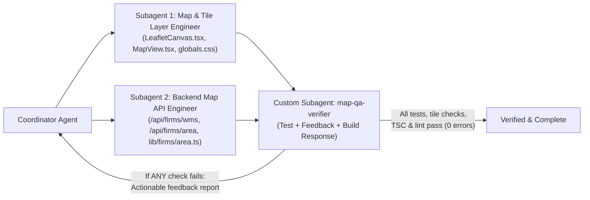

# Implementation Plan: Eliminating Black Map Tiles & Zoom Blackouts (`docs/implementation/map-black-zoom-fix-plan.md`)

## 1. Context & Why Removing the Clouds Introduced Black Tiles

When the cloud-covered NASA GIBS layer (`VIIRS_SNPP_CorrectedReflectance_TrueColor`) was removed, **black 256×256 tiles** appeared on the map and during zooming due to a combination of four verified issues in the tile pipeline and backend WMS proxy:

1. **Redundant `<WMSTileLayer url="/api/firms/wms" opacity={0.9}>` Painting Black Tiles ([src/components/map/LeafletCanvas.tsx](file:///c:/Users/Acer-Pc/Desktop/FireMemory/src/components/map/LeafletCanvas.tsx#L579-L592), [src/app/api/firms/wms/route.ts](file:///c:/Users/Acer-Pc/Desktop/FireMemory/src/app/api/firms/wms/route.ts#L66-L111)):**
   - NASA FIRMS MapServer (`firms.modaps.eosdis.nasa.gov/mapserver/wms/fires/...`) defaults to `IMAGECOLOR 0 0 0` (solid black background) when `TRANSPARENT` is lowercase `"true"` instead of uppercase `"TRUE"` or when returning RGB PNG tiles (`IHDR` `colorType = 2`, no alpha channel).
   - Because `<WMSTileLayer>` is rendered at `opacity={0.9}` on top of the basemap while `<DetectionLayer>` already renders the interactive orange-to-red hotspot markers and clusters from `/api/firms/area`, any opaque tile returned by `/api/firms/wms` paints a **90% opaque black square** directly over the map.
2. **Missing `maxNativeZoom` on Cloud-Free Satellite Basemap & Broken GIBS Overlay Tiles ([src/components/map/LeafletCanvas.tsx](file:///c:/Users/Acer-Pc/Desktop/FireMemory/src/components/map/LeafletCanvas.tsx#L539-L577)):**
   - `MapContainer` allows `maxZoom={18}`, but Esri `World_Imagery` has no `maxNativeZoom` configured. Over Philippine provinces and rural municipalities, satellite tiles only exist natively up to zoom `13–15`. Zooming past level 13 causes Leaflet (`_pruneTiles`) to discard the loaded zoom-13 tiles and request non-existent zoom 14–18 tiles, leaving **black tile holes** where the `#020617` `.map-workspace` background shows through.
   - The two NASA GIBS overlay layers (`Reference_Features_15m` and `Reference_Labels_15m` using `/default/GoogleMapsCompatible_Level13/{z}/{y}/{x}.png`) omit the second `/default/` WMTS time dimension segment and fail at several zoom levels, generating failed tile slots.
3. **Leaflet CSS `mix-blend-mode: plus-lighter` + Pitch-Black `#020617` Container ([src/app/globals.css](file:///c:/Users/Acer-Pc/Desktop/FireMemory/src/app/globals.css#L2281-L2283), `node_modules/leaflet/dist/leaflet.css`):**
   - `leaflet.css` line 63 sets `.leaflet-container img.leaflet-tile { mix-blend-mode: plus-lighter; }`, while `globals.css` line 2281 sets `.map-workspace { background: #020617; }` (pitch black) with no `.leaflet-container` or `.leaflet-tile` override. During zoom animations (`leaflet-fade-anim` / `leaflet-zoom-anim`), unloaded or fading tiles expose the `#020617` black background and corrupt stacked tile compositing.
4. **Main-Thread Zoom Stall & Multi-Chunk NRT Timeout ([src/components/map/LeafletCanvas.tsx](file:///c:/Users/Acer-Pc/Desktop/FireMemory/src/components/map/LeafletCanvas.tsx#L216-L260), [src/lib/firms/area.ts](file:///c:/Users/Acer-Pc/Desktop/FireMemory/src/lib/firms/area.ts#L246-L290)):**
   - `HotspotFootprintLayer` renders up to 2,000 SVG `L.circle` elements across the entire country on every `zoomend` at `z >= 10` instead of filtering to `map.getBounds()`, stalling tile decoding during zoom.
   - `fetchFirmsArea` runs up to 18+ sequential NRT requests when `liveRange` is `"month"` or `"year"` before falling back to the local archive.

---

## 2. Subagent Architecture & Iterative Loop Engineering

To execute this cleanly, we use **specialized worker subagents** paired with a dedicated **QA Test, Feedback & Build Verifier Subagent** created via `define_subagent`:

### Custom Subagent Definition (`map-qa-verifier`)
- **Name:** `map-qa-verifier`
- **Role:** Automated Map QA, Backend API Tester & Build Verifier
- **Capabilities:** Read/write test files, run diagnostic scripts, run `npx tsc --noEmit`, `npm run lint`, and `node --test`, inspect tile URLs and PNG binary headers, and produce a structured **PASS / FAIL + Actionable Feedback Report**.
- **Loop Rule:** The coordinator and worker subagents **must not stop** until `map-qa-verifier` reports **100% PASS** across all tile layers, backend endpoints, CSS rules, TypeScript checks, and test suites.

---

## 3. Workstream Ownership & Exact Technical Fixes

### Workstream 1 — Cloud-Free Multi-Layer Basemap & Zoom Continuity (`src/components/map/LeafletCanvas.tsx`, `src/components/map/MapView.tsx`)
1. **Guaranteed Cloud-Free Land Basemap Across All Zooms (`z = 4..18`) with Zero Black Tiles:**
   - **Base Underlay (`TileLayer` #1):** CARTO Voyager / OSM clean land-and-coastline raster tiles (`https://{s}.basemaps.cartocdn.com/rastertiles/voyager_nolabels/{z}/{x}/{y}{r}.png`, `minZoom={4}`, `maxZoom={18}`, `maxNativeZoom={18}`) so land and water geometry is always present up to street zoom `z=18`.
   - **Cloud-Free Satellite Land Layer (`TileLayer` #2):** Esri `World_Imagery` (`https://server.arcgisonline.com/ArcGIS/rest/services/World_Imagery/MapServer/tile/{z}/{y}/{x}`) with **`minZoom={4}`**, **`maxNativeZoom={13}`**, **`maxZoom={18}`**, and `errorTileUrl` set to a `1×1` transparent PNG data URI. Setting `maxNativeZoom={13}` ensures Leaflet **retains and smoothly scales zoom-13 satellite tiles when zooming to `z = 14..18`** instead of pruning them or showing black tiles over rural provinces.
   - **Cloud-Free Borders & Labels (`TileLayer` #3):** Replace the broken NASA GIBS `Level13` URLs with Esri `World_Boundaries_and_Places` (`https://services.arcgisonline.com/ArcGIS/rest/services/Reference/World_Boundaries_and_Places/MapServer/tile/{z}/{y}/{x}`, `minZoom={4}`, `maxNativeZoom={13}`, `maxZoom={18}`, `errorTileUrl` transparent PNG).
2. **Eliminate Black WMS Tile Overlay:**
   - Remove the redundant `<WMSTileLayer url="/api/firms/wms">` from `LeafletCanvas.tsx` because `<DetectionLayer hotspots={hotspots} />` and `<HotspotFootprintLayer hotspots={hotspots} />` already render all live and historical thermal detections in the unified orange-to-red CDRRMO palette without painting opaque black WMS tiles over the map.
3. **Viewport-Bounded Footprints on Zoom (`HotspotFootprintLayer`):**
   - Filter `hotspots` by `map.getBounds().pad(0.25)` inside `renderFootprints` and attach to both `zoomend` and `moveend` so zooming to `z >= 10` only renders the circles visible on screen.

### Workstream 2 — Backend Map APIs (`src/app/api/firms/wms/route.ts`, `src/app/api/firms/area/route.ts`, `src/lib/firms/area.ts`)
1. **Harden `/api/firms/wms/route.ts` Against Opaque Black Tiles:**
   - Send uppercase `TRANSPARENT=TRUE` to upstream MapServer.
   - Inspect the upstream PNG `IHDR` header (byte 25 `colorType`): if the upstream image is not a valid PNG or is an opaque RGB/grayscale PNG (`colorType === 2` or `colorType === 0` without a `tRNS` chunk), return `transparentPngResponse()` (`1×1` RGBA transparent PNG) so an opaque black tile can **never** be returned by `/api/firms/wms`.
   - Add `Cache-Control: public, max-age=300, stale-while-revalidate=600` on valid responses.
2. **Fast Live/Archive Resolution in `src/lib/firms/area.ts` & `/api/firms/area/route.ts`:**
   - When `start..end` spans more than `10` days (e.g., `"month"` or `"year"` range), avoid running 18–200 sequential NRT requests; query at most the latest 5-day NRT window with a `5_000ms` timeout and seamlessly fall back to `queryHotspots` for historical/archive coverage.

### Workstream 3 — Global CSS Tile & Container Hardening (`src/app/globals.css`)
1. Override Leaflet's problematic default blend mode and pitch-black background:
   - `.leaflet-container { background: #0d1f33 !important; }` (natural deep ocean/slate tone instead of `#020617` pitch black)
   - `.leaflet-container img.leaflet-tile { mix-blend-mode: normal !important; }` (disables `leaflet.css` `plus-lighter` additive blending artifacts across stacked tile layers)
   - Ensure `.leaflet-tile-pane` and `.leaflet-layer` maintain clean opacity transitions during zoom.

### Workstream 4 — Automated QA Verification & Feedback Loop (`tests/ai/map-zoom-api.test.mjs`)
1. Create `tests/ai/map-zoom-api.test.mjs` testing:
   - `/api/firms/wms` rejects opaque black RGB PNGs (`colorType = 2`) and returns a transparent RGBA PNG (`colorType = 6`), and sends `TRANSPARENT=TRUE`.
   - `/api/firms/area` resolves `"today"`, `"7days"`, `"month"`, and `"year"` windows without hanging or returning 500.
   - `LeafletCanvas.tsx` configures `maxNativeZoom` and `errorTileUrl` on all tile layers, removes black-tile-inducing URLs, and filters `HotspotFootprintLayer` by `map.getBounds()`.
   - `src/app/globals.css` explicitly overrides `.leaflet-container img.leaflet-tile` to `mix-blend-mode: normal !important` and sets a non-black `.leaflet-container` surface.
2. Run the `map-qa-verifier` subagent in a loop until all tests, `npx tsc --noEmit`, and `npm run lint` pass with zero errors.
